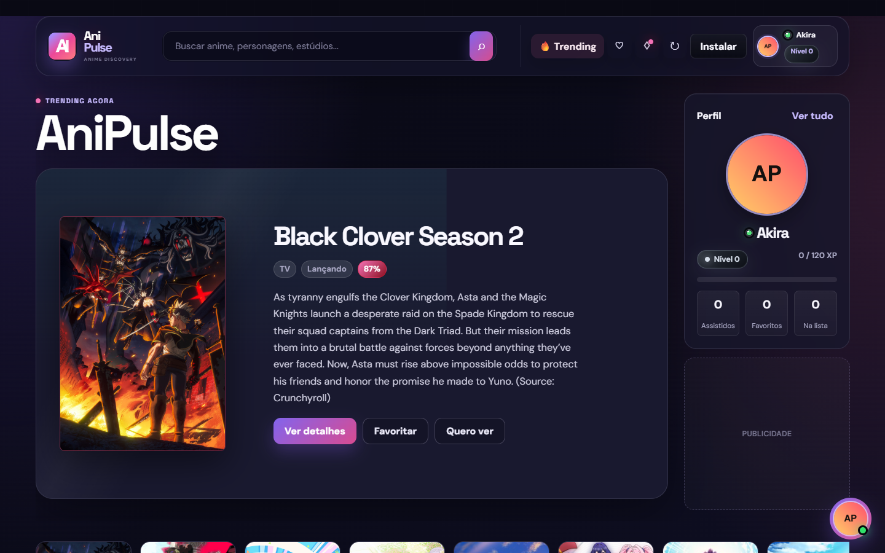
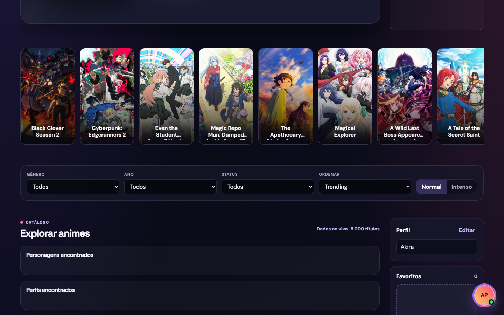
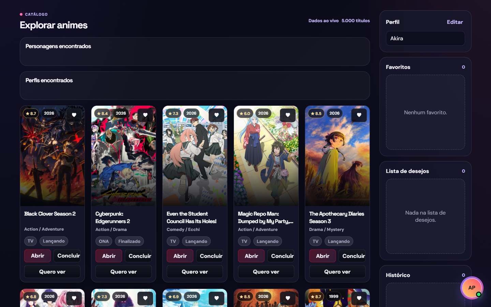
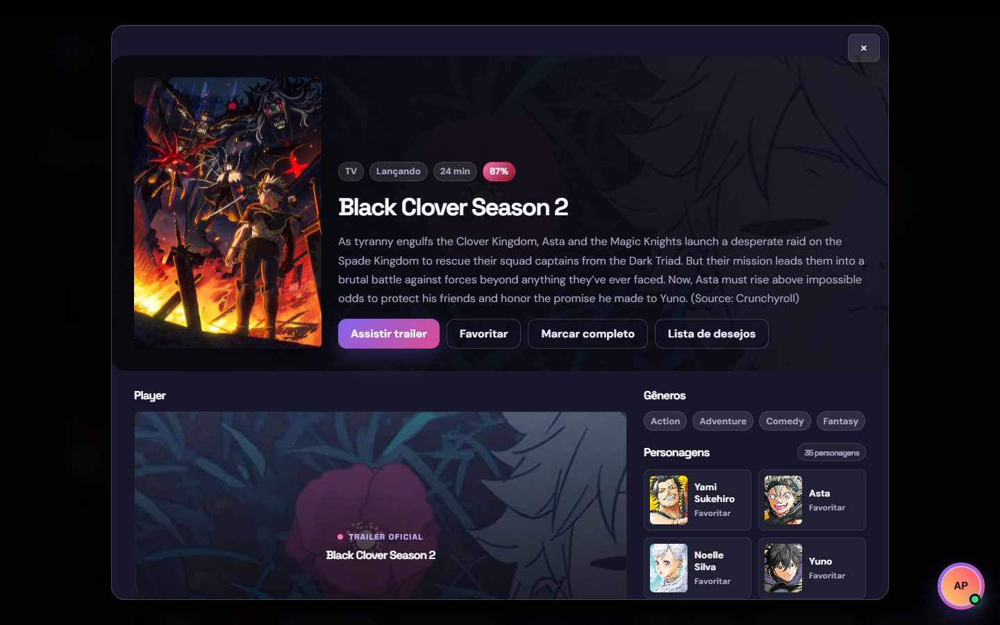
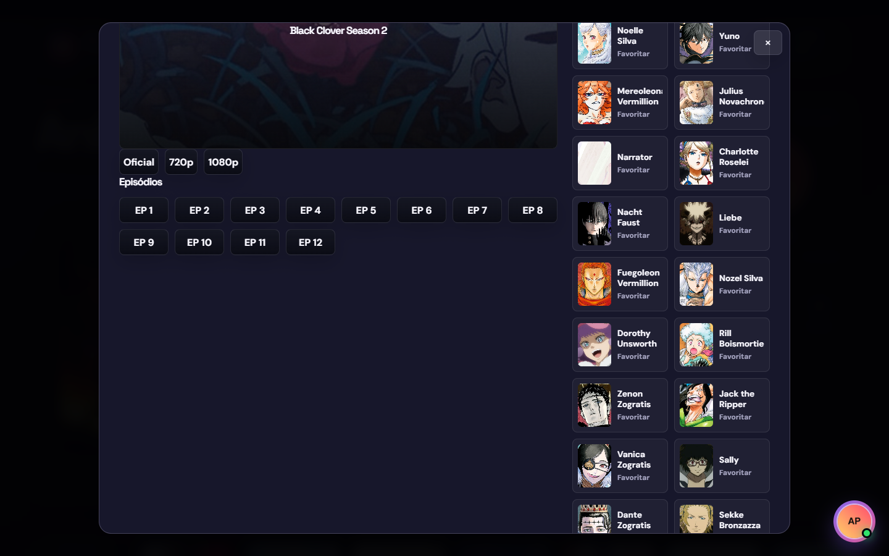
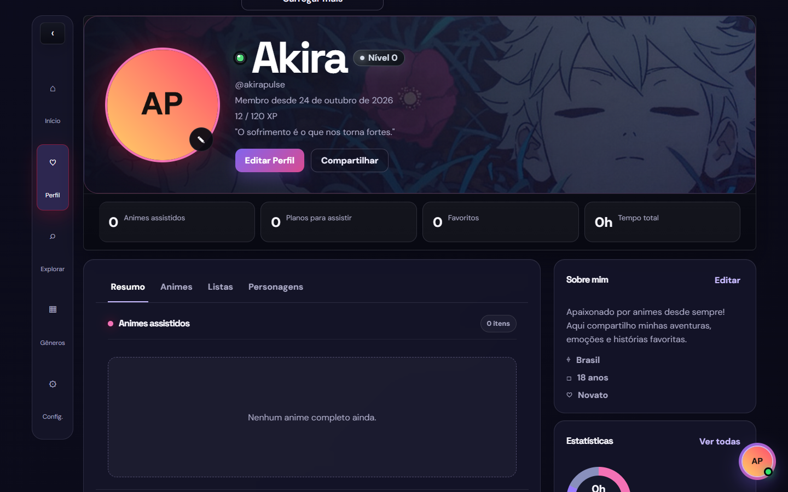
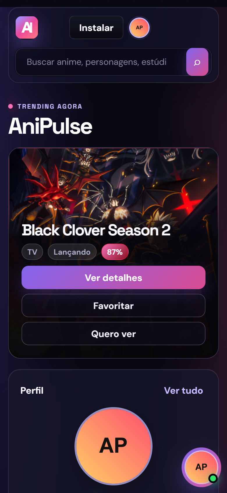

<div align="center">


# AniPulse

**Catálogo de animes moderno, escuro e responsivo, feito 100% com HTML, CSS e JavaScript puro.**

<p>
  
  
</p>
<p>
  
  
  
  
  
</p>

</div>

> [!WARNING]
> **Este é apenas um projeto de teste.** O AniPulse foi criado para estudo e experimentação de interface. Ele **não está publicado e não vai para o ar**: não existe versão online, domínio ou serviço oficial. Tudo aqui roda só localmente, na sua máquina.

<p align="center">
  
</p>

---

## ✨ Sobre o projeto

O **AniPulse** é um site de descoberta de animes com visual escuro, detalhes em gradiente roxo/rosa e cara de app. Ele busca dados reais na API pública da [AniList](https://anilist.co) (trending, gêneros, personagens, recomendações e trailers oficiais) e guarda as preferências do usuário direto no navegador.

Não tem back-end, banco de dados nem framework: é só abrir um servidor local e usar.

## 📸 Prints do site rodando

<table>
  <tr>
    <td width="50%"></td>
    <td width="50%"></td>
  </tr>
  <tr>
    <td align="center"><sub><b>Carrossel de trending + filtros</b></sub></td>
    <td align="center"><sub><b>Catálogo com notas, gêneros e ações rápidas</b></sub></td>
  </tr>
  <tr>
    <td width="50%"></td>
    <td width="50%"></td>
  </tr>
  <tr>
    <td align="center"><sub><b>Detalhes com sinopse, gêneros e trailer</b></sub></td>
    <td align="center"><sub><b>Lista de episódios e personagens</b></sub></td>
  </tr>
  <tr>
    <td width="50%"></td>
    <td width="50%" align="center"></td>
  </tr>
  <tr>
    <td align="center"><sub><b>Perfil com nível, XP e estatísticas</b></sub></td>
    <td align="center"><sub><b>Layout responsivo no celular</b></sub></td>
  </tr>
</table>

## 🚀 Funcionalidades

| | Recurso | Descrição |
|---|---|---|
| 🔥 | **Trending** | Destaque principal e carrossel com os animes em alta, ao vivo da AniList |
| 🔎 | **Busca e filtros** | Busca por nome, personagens e estúdios; filtros por gênero, ano, status e ordenação |
| 🎬 | **Página de detalhes** | Sinopse, gêneros, duração, nota, personagens, recomendações e trailer oficial |
| ❤️ | **Favoritos e listas** | Favoritos, lista de desejos e histórico salvos no `localStorage` |
| 👤 | **Perfil gamificado** | Avatar, banner, bio, nível e XP, estatísticas e personagens favoritos |
| 💬 | **Chat (demo)** | Chat e chamadas simulados localmente, só para testar a interface |
| 📱 | **Responsivo + PWA** | Funciona no celular e pode ser "instalado" via manifesto e service worker |
| ⚡ | **Cache offline** | Script em Node que salva um cache da AniList para a página nunca abrir vazia |

## 🛠️ Tecnologias

- **HTML5 + CSS3**: layout com grid, glassmorphism e tema escuro
- **JavaScript (vanilla)**: toda a lógica do app, sem frameworks
- **AniList GraphQL API**: fonte dos dados de animes e personagens
- **Service Worker + Web App Manifest**: suporte a PWA
- **Node.js**: script opcional de atualização do cache

## 💻 Como rodar localmente

> Lembrando: é um projeto de teste, feito para rodar **só na sua máquina**.

```bash
git clone https://github.com/Yuyusukii/anipulse.git
cd anipulse
python -m http.server 5177
```

Depois abra **http://localhost:5177** no navegador.

### Cache opcional

```bash
# atualiza o cache uma vez
node update-cache.js

# ou fica atualizando a cada 30 minutos
node update-cache.js --watch --interval-minutes=30
```

O site tenta carregar `data/anime-cache.json` primeiro e depois busca os dados ao vivo na AniList. Se a API estiver fora do ar, o cache mantém a página preenchida.

## 📁 Estrutura

```
anipulse/
├── index.html            # estrutura da página
├── styles.css            # estilos principais
├── redesign.css          # camada visual do redesign
├── app.js                # lógica do app (busca, detalhes, perfil, chat...)
├── service-worker.js     # cache do PWA
├── manifest.webmanifest  # manifesto do PWA
├── update-cache.js       # script Node que gera o cache da AniList
├── start-auto-update.ps1 # atalho no PowerShell para o modo contínuo
├── IMAGENS/              # logo / avatar padrão
└── screenshots/          # prints usados neste README
```

## ⚖️ Aviso

- Projeto **sem fins comerciais**, feito para estudo. **Não está hospedado em lugar nenhum.**
- Os dados e as imagens dos animes vêm da API pública da [AniList](https://anilist.co) e pertencem aos seus respectivos detentores.
- Os trailers são os **oficiais**, incorporados do YouTube. O projeto não hospeda vídeos e não faz scraping de sites de terceiros.
- Os espaços de "Publicidade" são só marcadores visuais, sem anúncios reais.

---

<div align="center">
  <sub>Feito com 💜 por <a href="https://github.com/Yuyusukii">Yuyusukii</a> · projeto de teste, não vai ao ar</sub>
</div>
