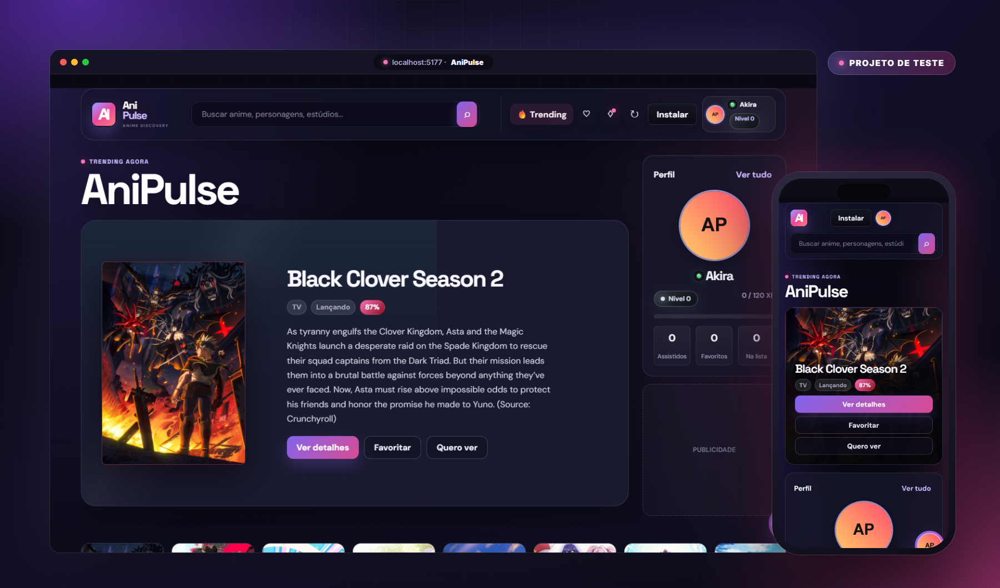
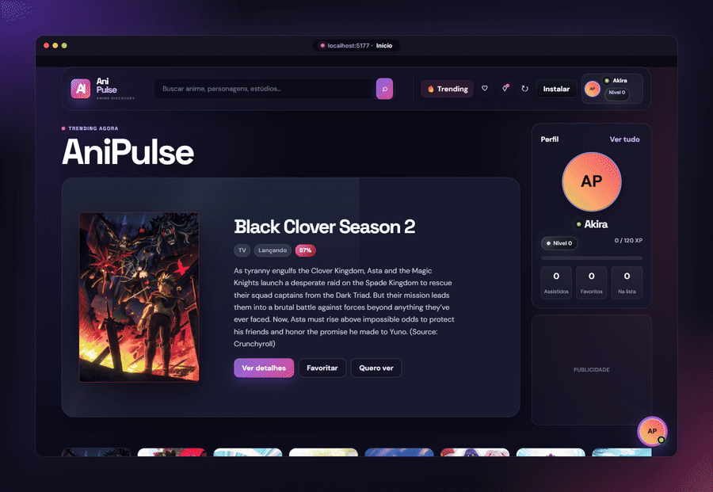
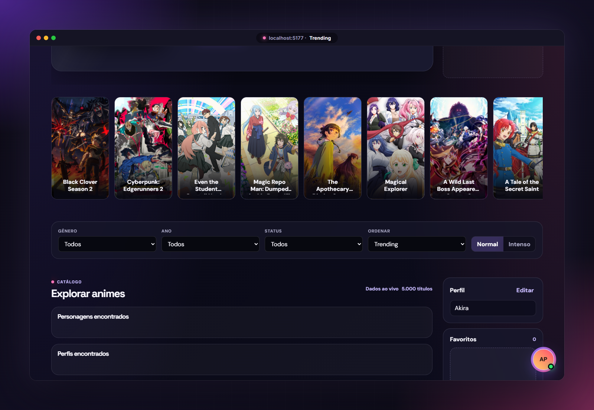
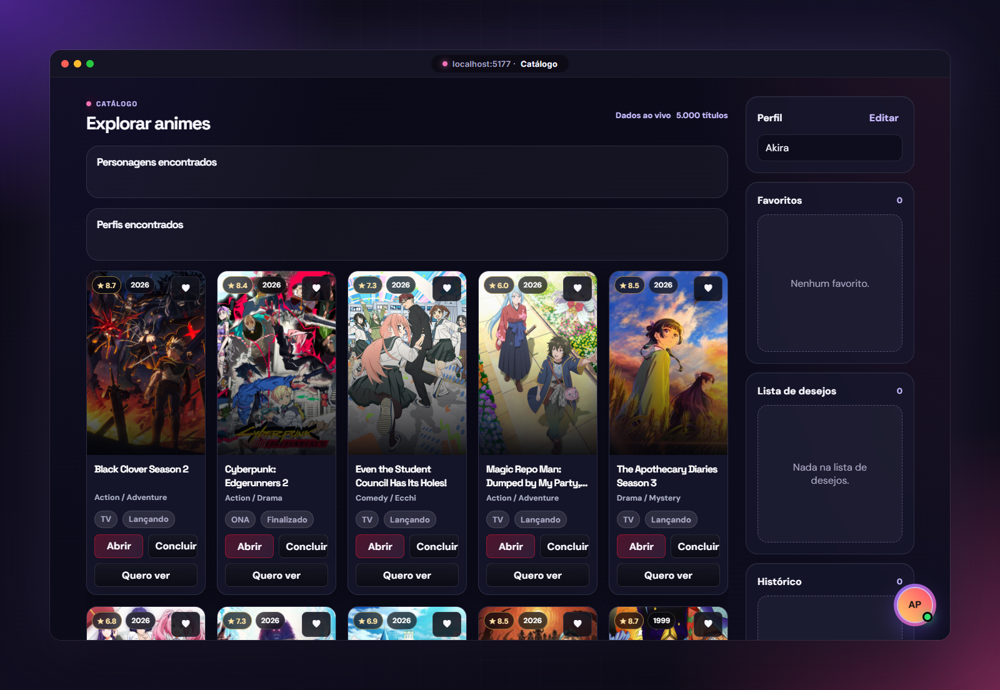
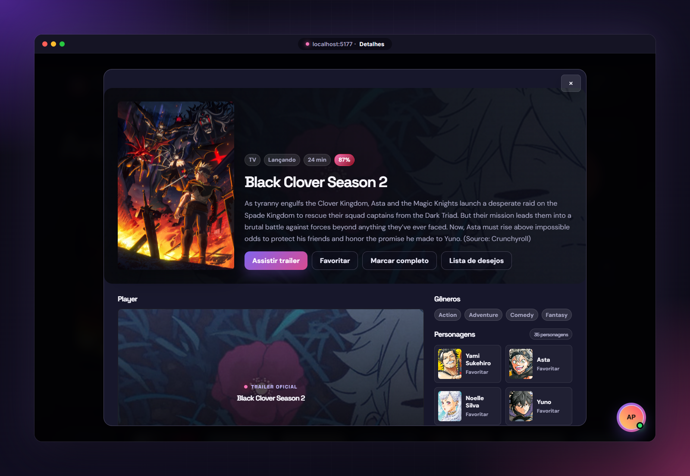
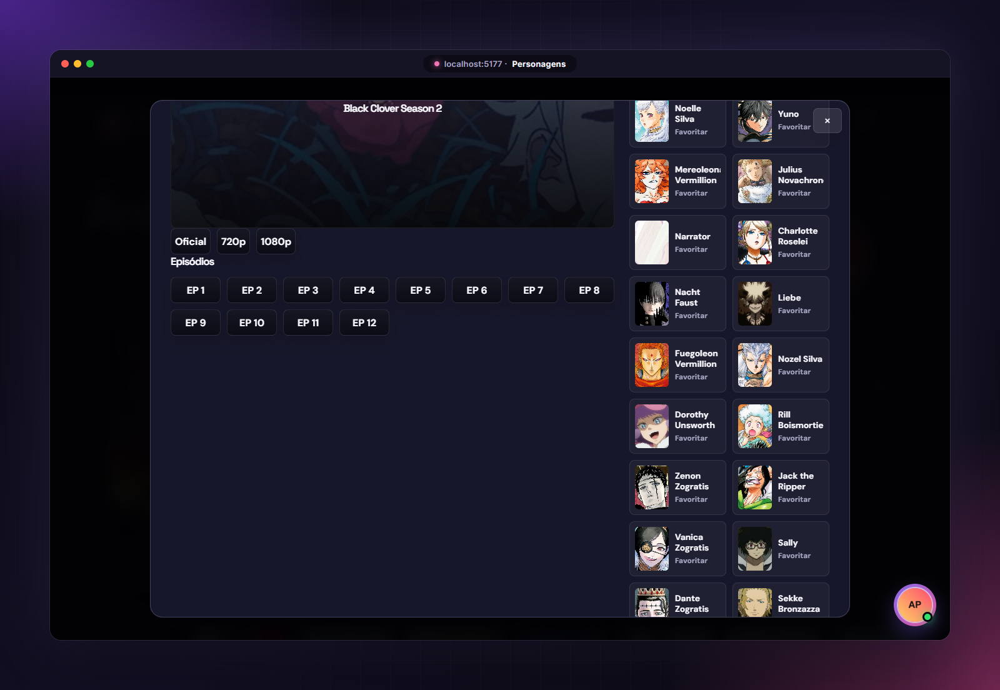
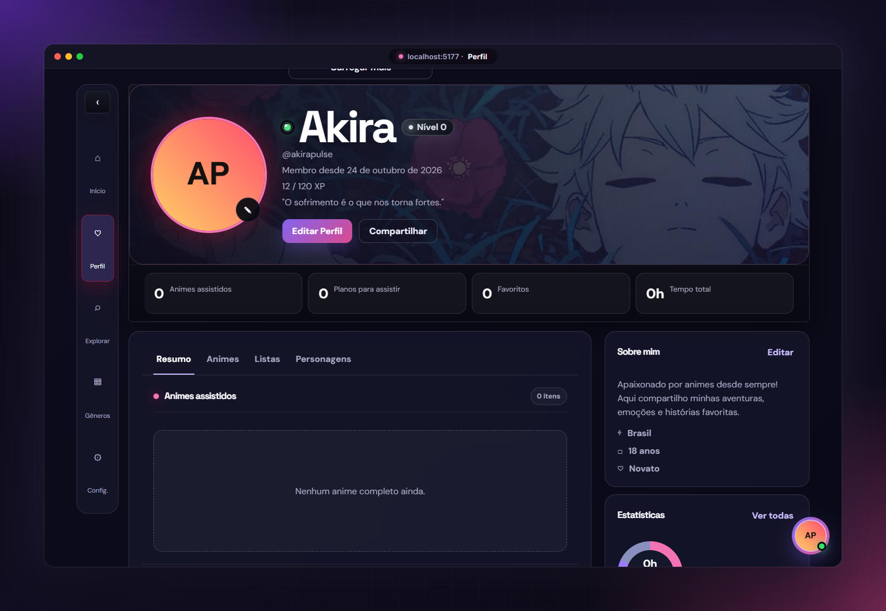

<p align="center">

</p>

<p align="center">

</p>

<p align="center">


</p>

<p align="center">
<a href="#-sobre">Sobre</a>
&nbsp;·&nbsp;
<a href="#-preview">Preview</a>
&nbsp;·&nbsp;
<a href="#-funcionalidades">Funcionalidades</a>
&nbsp;·&nbsp;
<a href="#-galeria">Galeria</a>
&nbsp;·&nbsp;
<a href="#-rodando-localmente">Rodar localmente</a>
</p>

<p align="center">

</p>

> [!WARNING]
> **Isto é só um teste.** O AniPulse é um projeto pessoal de estudo de interface. Ele **não está publicado e não vai para o ar**: não tem domínio, hospedagem nem versão oficial. Tudo que aparece aqui roda apenas localmente.

---

## 🌙 Sobre

O **AniPulse** é um site de descoberta de animes com visual escuro, gradientes roxo/rosa e cara de aplicativo. Os dados são reais e vêm da API pública da [AniList](https://anilist.co): trending, gêneros, personagens, recomendações e trailers oficiais. Favoritos, listas e o perfil ficam salvos no próprio navegador.

O site não tem back-end, banco de dados nem framework. É HTML, CSS e JavaScript puro: abriu um servidor local, funcionou.

| Descobrir | Explorar | Acompanhar |
| :---: | :---: | :---: |
| Destaque do momento e carrossel de trending | Busca com filtros por gênero, ano, status e ordem | Favoritos, lista de desejos, histórico e perfil com XP |

## 🎞️ Preview

<p align="center">

</p>

## ✨ Funcionalidades

- 🔥 **Trending ao vivo**: destaque principal e carrossel com os animes em alta na AniList
- 🔎 **Busca completa**: por anime, personagem ou estúdio, com filtros de gênero, ano, status e ordenação
- 🎬 **Página de detalhes**: sinopse, nota, duração, gêneros, episódios, personagens e trailer oficial
- ❤️ **Favoritos e listas**: favoritos, lista de desejos e histórico salvos no `localStorage`
- 👤 **Perfil gamificado**: avatar, banner, bio, nível, XP, estatísticas e personagens favoritos
- 💬 **Chat demo**: chat e chamadas simulados no próprio navegador, só para testar a interface
- 📱 **Responsivo e PWA**: funciona bem no celular e pode ser "instalado" como app
- ⚡ **Cache inteligente**: script em Node salva um cache da AniList para a página nunca abrir vazia

## 🖼️ Galeria

<table>
<tr>
<td width="50%"></td>
<td width="50%"></td>
</tr>
<tr>
<td align="center"><b>Trending + filtros</b><br><sub>Carrossel dos animes em alta e filtros do catálogo</sub></td>
<td align="center"><b>Catálogo</b><br><sub>Cards com nota, ano, gêneros e ações rápidas</sub></td>
</tr>
<tr>
<td width="50%"></td>
<td width="50%"></td>
</tr>
<tr>
<td align="center"><b>Detalhes</b><br><sub>Sinopse, gêneros, player e trailer oficial</sub></td>
<td align="center"><b>Episódios e personagens</b><br><sub>Lista de episódios e elenco completo</sub></td>
</tr>
<tr>
<td colspan="2"></td>
</tr>
<tr>
<td colspan="2" align="center"><b>Perfil</b><br><sub>Nível, XP, estatísticas, listas e "sobre mim"</sub></td>
</tr>
</table>

## 🧰 Tecnologias

<p align="center">

</p>

| Camada | Tecnologia |
| --- | --- |
| Interface | HTML5, CSS3 (grid, glassmorphism, tema escuro) |
| Lógica | JavaScript puro, sem frameworks |
| Dados | AniList GraphQL API |
| App | Service Worker + Web App Manifest (PWA) |
| Cache | Script Node.js (`update-cache.js`) |
| Armazenamento | `localStorage` do navegador |

## 💻 Rodando localmente

> Lembrando que é um projeto de teste, feito para rodar **só na sua máquina**.

```bash
git clone https://github.com/Yuyusukii/anipulse.git
cd anipulse
python -m http.server 5177
```

Abra **http://localhost:5177** e pronto.

<details>
<summary><b>Cache opcional da AniList</b></summary>

<br>

```bash
# atualiza o cache uma vez
node update-cache.js

# fica atualizando a cada 30 minutos
node update-cache.js --watch --interval-minutes=30
```

O site tenta carregar `data/anime-cache.json` primeiro e depois busca os dados ao vivo. Se a AniList estiver fora do ar, o cache mantém a página preenchida.

</details>

<details>
<summary><b>Estrutura do projeto</b></summary>

<br>

```text
anipulse/
├── index.html             estrutura da página
├── styles.css             estilos principais
├── redesign.css           camada visual do redesign
├── app.js                 lógica do app (busca, detalhes, perfil, chat...)
├── service-worker.js      cache do PWA
├── manifest.webmanifest   manifesto do PWA
├── update-cache.js        gera o cache da AniList
├── start-auto-update.ps1  modo contínuo no PowerShell
├── IMAGENS/               logo / avatar padrão
└── docs/                  imagens deste README
```

</details>

## ⚖️ Aviso

| | |
| --- | --- |
| 🧪 | Projeto **de teste**, sem fins comerciais. **Não está hospedado e não vai ao ar.** |
| 🗂️ | Dados e imagens dos animes vêm da [AniList](https://anilist.co) e pertencem aos respectivos detentores. |
| ▶️ | Os trailers são os **oficiais**, incorporados do YouTube. Nenhum vídeo é hospedado aqui. |
| 📢 | Os espaços de "Publicidade" são só marcadores visuais, sem anúncios reais. |

<p align="center">

</p>

<p align="center">
<sub>feito por <a href="https://github.com/Yuyusukii">Yukki</a> · só um teste, não vai ao ar 💜</sub>
</p>

<p align="center">

</p>
